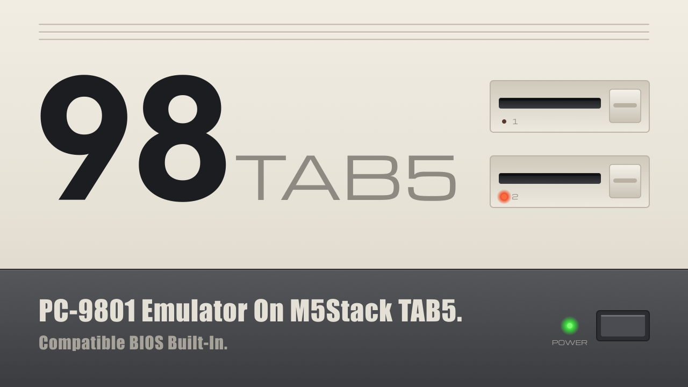
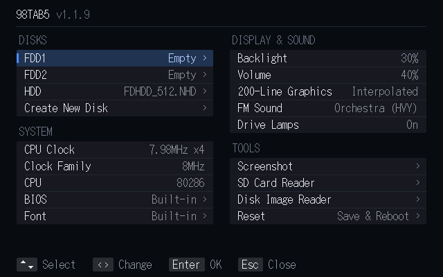

# 98TAB5





A **PC-9801 emulator for the M5Stack Tab5**. Of the outside sources that its
predecessor, np2 TAB5, contained, everything except the font has been dropped,
and the emulator itself (the CPU and the devices) has been written anew.

日本語: [README.jp.md](README.jp.md)

---

## 1. Features

### Compatible ROMs built in

A simple BIOS and a public-domain font are built into the firmware.
**It boots from a blank microSD card — no ROM from real hardware is needed.**
The so-called NEC protection is not supported. To use NEC's MS-DOS or games
that include it, dump the BIOS from a real machine and use that. N88(86)-BASIC
is not included for copyright reasons.

### USB keyboard and mouse

ESP-IDF does not support it, so **a USB keyboard and a USB mouse cannot be used
at the same time.**

### Bluetooth keyboard and mouse

BLE only. Devices that require a passcode to pair are not supported.

### Touch panel as a mouse

The touch panel acts as a mouse.

### Screenshots

Saves a hard copy of the screen to the microSD card as a PNG.

### SD Card Reader mode

Mounts the microSD card in the Tab5 as a folder on a PC.
The transfer rate is about 0.6MB/s, which is very slow.
Bluetooth is off while this mode runs; tap the screen to leave it.

### Disk Image Reader mode

Mounts a mounted disk image as a folder on a PC: the HDD, or the floppy image in
FDD1 / FDD2 (`.NFD` `.D88` `.HDM` `.FDI`).
The transfer rate is about 0.6MB/s, which is very slow.
Bluetooth is off while this mode runs; tap the screen to leave it.

### Simple support for 386 instructions

With **CPU: 80286 + 386 Instructions** in the menu (the default), some real-mode
software that uses 386 instructions runs. Protected mode is not supported.
The machine identifies itself as a 286.

### Sound modes

**FM Sound** offers **Original, Hall, Synthesizer (HVY), Orchestra (HVY)**, in that order. Orchestra replaces the instruments with a compact bank of real-instrument samples. Sample credits are in [components/pc98core/sound/samples/](components/pc98core/sound/samples/).
F12 offers an 8 MHz / 10 MHz Clock Family setting, applied on Reset.

## 2. Building

### (1) Build

A plain ESP-IDF project (no Arduino core, no PlatformIO).

**Requires ESP-IDF v5.5. It will not build on v6.x.**

```sh
git clone https://github.com/mochimochi-man/98TAB5.git
cd 98TAB5
. $HOME/esp/esp-idf/export.sh     # wherever your IDF v5.5 lives
idf.py build
```

There is no `idf.py set-target` step: the target is already set in
`sdkconfig.defaults`. The first build fetches the components pinned in
`dependencies.lock`, which takes a few minutes.

`./build.sh` does the same and finds ESP-IDF for you.

### (2) Flashing

```sh
idf.py -p <PORT> flash monitor
```

`<PORT>` is `/dev/ttyACM0` on Linux, `/dev/cu.usbmodem*` on macOS, `COMn` on
Windows. The Tab5's USB-C port appears as a USB-Serial-JTAG device. Leave the
monitor with `Ctrl-]`. `./flash.sh [PORT]` is the same thing.

#### Without a toolchain

Pre-built firmware is in [`firmware/`](firmware/).

For a new installation, write the merged image, which contains the bootloader,
partition table, initial OTA data and application:

```sh
python -m esptool --chip esp32p4 --port <PORT> --baud 460800 write_flash 0x0 firmware/98TAB5-public-1.2.0-20261109.bin
```

For an update with the same partition layout, write only the application to
preserve disk selection, CPU clock, backlight, volume and Bluetooth pairings
stored in NVS:

```sh
python -m esptool --chip esp32p4 --port <PORT> --baud 460800 write_flash 0x10000 firmware/pc98tab5-app.bin
```

The merged image can overwrite settings. See [`firmware/README.jp.md`](firmware/README.jp.md)
for firmware details and validation scope.

#### Clearing settings

To start completely fresh:

```sh
esptool --chip esp32p4 -p <PORT> erase-flash    # then write as above
```

To clear only the settings and keep the firmware:

```sh
esptool --chip esp32p4 -p <PORT> erase-region 0x9000 0x5000
```

---

## 3. Running it

Put a disk image (`.NFD`, `.NHD` and so on) in the root of a microSD card
formatted as FAT32, insert it into the Tab5 and switch on: the built-in
compatible simple BIOS starts.

**F11, F12 or Pause** opens the built-in menu.

Choose disk images for FDD1 / FDD2 / CD-ROM / HDD and leave the menu with **Reset**: the
machine restarts with those images mounted.

CD-ROM takes a CD image (`.ISO` or `.CUE`).

If you have a `BIOS.ROM` or `FONT.ROM` dumped from real hardware, put it in the
root of the microSD card and select it in the menu. It takes precedence over the
built-in ROMs.

### Connecting Bluetooth devices

**Listening does not stop until both a keyboard and a mouse are connected. There
is no time limit.**

- Switch a device on at any time, right after power-on or long afterwards, and it
  connects within about a second.
- Wake a sleeping device by pressing a key or moving the mouse.
- Listening stops once a keyboard and a mouse are both connected.

## 4. Notes

- As of the latest builds, the M5Stack Tab5 uses one of
  **ILI9881C (ver.1) / ST7123 (ver.2) / ST7121 (ver.3)** for its display.
  The ILI9881C (ver.1) is not supported, as it could not be checked on real
  hardware.
- MIDI is not supported.

---

## 5. Licence

The licence specific to this program, including the built-in compatible simple
BIOS, is the **MIT licence**.

The libraries and sources it uses each have their own licences, however. See
**[LICENSE.md](LICENSE.md)** (English, the authoritative version) or
**[LICENSE.jp.md](LICENSE.jp.md)** (Japanese) for the details.

---

Copyright 2026 mochimochi-man / X: [@MochimochimanEX](https://x.com/MochimochimanEX)
