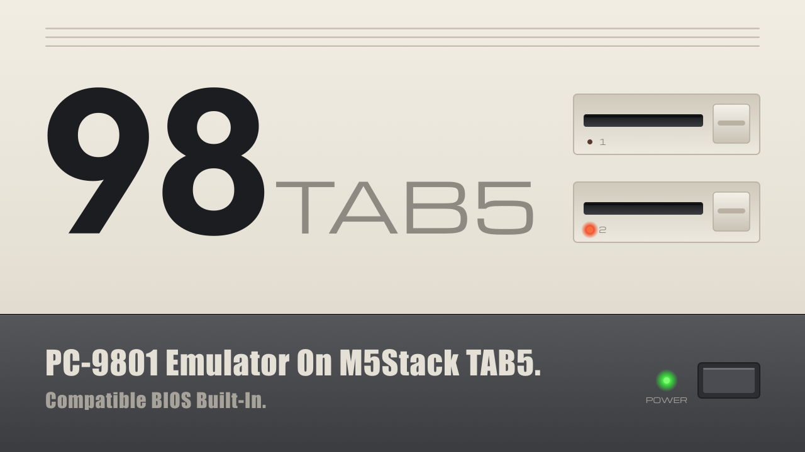
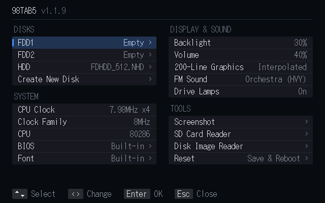

# 98TAB5





**M5Stack Tab5 用 PC-9801 エミュレータ**です。前身となるnp2 TAB5に含まれていた外部ソースのうち、
フォント以外のソースを廃し、エミュレータ本体（CPU とデバイス）をすべて新規に書き直しました。

English: [README.en.md](README.en.md)

---

## 1. 特徴

### 互換 ROM 内蔵

簡易 BIOS とパブリックドメインのフォントを内蔵しています。
**実機の ROM が無くても、空の microSD カードだけで起動します。**
ただし、俗にいう NEC プロテクトには対応しませんので、 NEC 製 MS-DOS やこれを含むゲームを利用されたい方は、
実機から BIOS を抽出する必要があります。また、 N88(86)-BASIC には著作権の都合上、対応しません。

### USB キーボード / マウス対応

ただし、ESP-IDF が未対応のため、**USB キーボードと USB マウスを同時に使用することはできません。**

### Bluetooth キーボード / マウス対応

BLE のみ対応。パスコード入力を要するタイプの機器には対応しません。

### マウスエミュレートタッチパネル

タッチパネルがマウスとして動作します。

### スクリーンショット機能

画面のハードコピーを microSD に PNG 形式で保存します。

### SD Card Reader モード

Tab5 に挿入された microSD を PC のフォルダとしてマウントできます。
転送速度は 0.6MB/s 程度と非常に遅いです。
モード中は Bluetooth が停止します。抜けるには画面をタップしてください。

### Disk Image Reader モード

マウント中のディスクイメージを PC のフォルダとしてマウントできます。対象は HDD、
または FDD1 / FDD2 のフロッピーイメージ（`.NFD` `.D88` `.HDM` `.FDI`）です。
転送速度は 0.6MB/s 程度と非常に遅いです。
モード中は Bluetooth が停止します。抜けるには画面をタップしてください。

### 386 命令簡易対応

メニューの **CPU: 80286 + 386 Instructions**（既定）で、386 命令を使う
リアルモードのソフトが一部動作します。プロテクトモードには対応しません。
CPU 判定には 286 として応答します。

### 音源モード

**FM Sound** は **Original, Hall, Synthesizer (HVY), Orchestra (HVY)** の順です。Orchestraは小容量の実楽器サンプルに置き換えます。サンプルの出典は [components/pc98core/sound/samples/](components/pc98core/sound/samples/) にあります。
F12のClock Familyで8MHz系／10MHz系を選択でき、Resetで適用します。

## 2. ビルド方法

### (1) ビルド

素の ESP-IDF プロジェクトです（Arduino コア・PlatformIO は使いません）。

**ESP-IDF v5.5 が必要です。v6.x ではビルドできません。**

```sh
git clone https://github.com/mochimochi-man/98TAB5.git
cd 98TAB5
. $HOME/esp/esp-idf/export.sh     # v5.5 を入れた場所
idf.py build
```

`idf.py set-target` は不要です（`sdkconfig.defaults` でターゲット指定済み）。
初回ビルドは `dependencies.lock` で固定されたコンポーネントを取得するため
数分かかります。

`./build.sh` でも同じことができます（ESP-IDF を自動で探します）。

### (2) 書き込み

```sh
idf.py -p <PORT> flash monitor
```

`<PORT>` は Linux なら `/dev/ttyACM0`、macOS なら `/dev/cu.usbmodem*`、
Windows なら `COMn` です。Tab5 の USB-C ポートは USB-Serial-JTAG として見えます。
モニタは `Ctrl-]` で抜けます。`./flash.sh [PORT]` でも同じです。

#### ツールチェーン無しで書き込む場合

ビルド済みファームウェアは [`firmware/`](firmware/) にあります。

新規に導入する場合は、ブートローダー・パーティションテーブル・OTA初期データ・
アプリを含む結合イメージを書き込みます。

```sh
python -m esptool --chip esp32p4 --port <PORT> --baud 460800 write_flash 0x0 firmware/98TAB5-public-1.2.0-20261109.bin
```

同じパーティション構成から更新する場合は、アプリ単体を書き込みます。
この方法では、NVSに保存したディスク選択・CPUクロック・バックライト・音量・
Bluetoothのペアリング情報を維持できます。

```sh
python -m esptool --chip esp32p4 --port <PORT> --baud 460800 write_flash 0x10000 firmware/pc98tab5-app.bin
```

結合イメージの書き込みでは設定が上書きされる場合があります。
詳細は [`firmware/README.jp.md`](firmware/README.jp.md) を参照してください。

#### 設定を初期化する場合

完全に初期状態から始めるには:

```sh
esptool --chip esp32p4 -p <PORT> erase-flash    # そのあと上記の書き込み
```

ファームウェアはそのままで設定だけ消すには:

```sh
esptool --chip esp32p4 -p <PORT> erase-region 0x9000 0x5000
```

---

## 3. 起動方法

ディスクイメージ（`.NFD` または `.NHD` など）を FAT32 でフォーマットした microSD
カードのルートに入れ、Tab5 に挿入して電源を入れると、内蔵の互換簡易 BIOS が
起動します。

**F11 / F12 / Pause** のいずれかで内蔵メニューが開きます。

FDD1 / FDD2 / CD-ROM / HDD に任意のディスクイメージを指定し、**Reset** でメニューを抜けると、
指定したディスクイメージをマウントして再起動します。

CD-ROM には CD イメージ（`.ISO` または `.CUE`）を指定できます。DOS から使うには、
`tools/cd98` の `CD98.SYS` と `CDEX98.COM`（または MSCDEX）を組み込んでください。

実機から吸い出した `BIOS.ROM` や `FONT.ROM` がある場合は、microSD のルートに置いて
メニューで指定してください。内蔵 ROM より優先されます。

### Bluetooth 機器の接続

キーボードとマウスの両方が接続されるまで、**待ち受けは止まりません。時間制限は
ありません。**

- 電源投入後でも、しばらく経ってからでも、機器の電源を入れれば約 1 秒で繋がります。
- 休止している機器は、キーを押す・マウスを動かすなどして起こしてください。
- キーボードとマウスが揃った時点で待ち受けを停止します。

## 4. 留意事項

- M5Stack Tab5 は、最新ビルド現在、液晶に
  **ILI9881C (ver.1) / ST7123 (ver.2) / ST7121 (ver.3)** のいずれかが使用されています。
  ILI9881C (ver.1) は、実機で確認できていないため、未対応です。
- MIDI には対応していません。

---

## 5. ライセンス

内蔵の互換簡易 BIOS を含む本プログラム固有のライセンスは **MIT ライセンス**です。

ただし、採用しているライブラリやソースごとに固有のライセンスがあります。
詳細は **[LICENSE.jp.md](LICENSE.jp.md)**（日本語）または
**[LICENSE.md](LICENSE.md)**（英語・正式版）を参照してください。

---

Copyright 2026 mochimochi-man / X: [@MochimochimanEX](https://x.com/MochimochimanEX)
